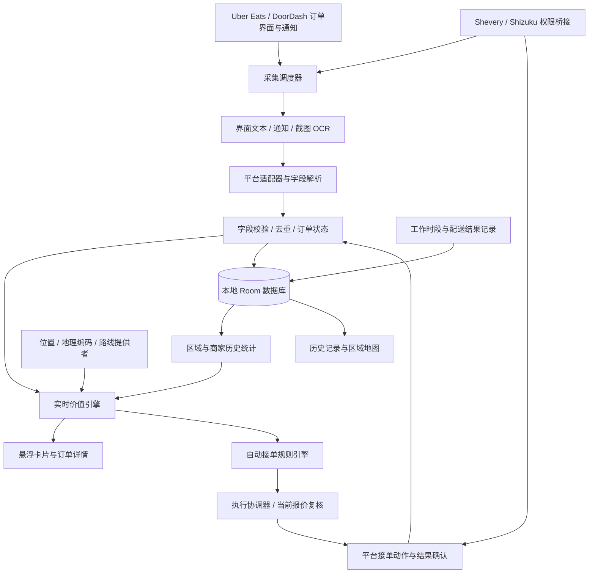

# Overud 架构草案

状态：提案，尚未进行设备或平台兼容性验证。

## 1. 产品范围与假设

Android 司机助手：识别收到的报价，分析当前订单价值、送达后的接单机会，积累个人区域经验。

- 首期暂按 Uber Eats + DoorDash 外卖订单设计；Uber 载客业务如需支持，应另建业务适配器及成本模型。
- 用户主动开启工作时段并授权采集；支持手动接单和用户开启的自动接单。自动接单仅在所有已启用的最低要求满足时执行。
- 首期单用户、本地保存、本地计算；云端同步和多人聚合属于后续扩展。
- 默认美元和英里，但数据模型显式保存币种、距离单位及当地时区。
- 不预设存在平台官方订单接口，不依赖读取平台私有数据库。

## 2. 设计原则

1. 采集渠道、平台解析、价值计算、区域统计相互独立。
2. 每个重要字段保留来源、时间、置信度；未知字段不能用 0 代替。
3. 平台报价、模型预测和实际收入分别保存。
4. 先输出可解释规则结果，积累数据后再训练模型。
5. 历史判断可重算：解析器、评分公式和区域模型均记录版本。
6. 实时分析不等待网络，外部信息到达后再更新结果。

## 3. 系统结构



这是独立 Android App，Shevery 是外部权限服务。桥接模块只暴露本项目需要的具体能力，不向业务层提供任意 shell 命令执行接口。

主采集路径选定为 Shevery/Shizuku UserService 内的 UI 自动化连接，读取界面节点并按需截图，由普通进程执行端侧 OCR。通知作为辅助触发和字段补充。Android 系统差异封装在 bridge；无障碍服务作为可替换采集/动作实现，不与特权 UI 自动化连接同时争用。此为架构选择，不代表已完成设备兼容实现。

## 4. 订单采集与 Shevery 边界

### 能力探测

启动时检查：Binder 是否连接、授权是否有效、运行身份、平台安装版本、可用采集渠道、悬浮窗和位置权限。权限丢失或 Binder 死亡时停止对应渠道，清楚显示状态并允许重新连接。

Shizuku API 提供 root/shell 身份执行能力，但 ADB 权限不等于 root；官方文档明确指出 shell 无法读取其他应用的私有数据文件。UserService 也不是常规 Android 应用进程。因此不能把“接入 Shevery”等同于“直接拿到订单”。

### 候选渠道

| 渠道 | 用途 | 验证要求 |
| --- | --- | --- |
| 界面结构/文本 | 提取报价、距离、时间、地址 | 验证无障碍节点或经授权的 UI 自动化路径是否可用 |
| 通知监听 | 新报价触发、补充文本 | 单独授权；通知可能不含完整字段 |
| 截图 + 端侧 OCR | 界面文本不足时补充 | 验证截图路径、授权和受保护窗口限制 |
| 位置记录 | 区域归属、到达、等待与空驶估计 | 明确位置精度与采样间隔 |

先针对目标包名和报价页面进行事件触发采集；必要时短时有限重试，避免持续高频截屏。文本解析优先，OCR 按需触发，保留截图时间、屏幕尺寸和裁剪区域用于诊断。

每个渠道返回 CapabilityResult：available / permission_required / disconnected / unsupported。Shevery 不可用时仅保留已经授权且仍能工作的渠道，不能宣称同等识别能力。

## 5. 平台解析与订单生命周期

适配器接口：识别页面类型 → 解析字段 → 合并同一报价的观察 → 推断状态事件。

- Uber Eats 与 DoorDash 各自维护解析规则，覆盖版本、语言、布局和单位。
- 保存报价总额、报价构成（若可见）、预计耗时、里程、商家、取送地点、停靠点、叠单及追加单信息。
- 明确区分“总里程”和“某一段里程”、“总耗时”和“单段耗时”；口径未知时标记未知。
- 同一截图中的字段优先作为一个原子观察；跨来源合并必须校验平台、时间窗口、金额和地点，避免把连续两单拼成一单。
- 优先用平台可见报价 ID；缺失时用工作时段、内容指纹和时间窗口去重，并保留报价修订，不能只按金额去重。
- 报价消失只表示不再可见，不自动认定为拒绝、过期或接单。
- 报价状态与配送状态分开：报价 observed / revised / no_longer_visible / accepted / declined / expired / unknown；配送 pickup / delivering / completed / cancelled / unknown。确认事件必须保存证据或用户确认来源。
- 允许并发报价、叠单和多平台切换；采集状态变化不能重置正在进行的配送。

金额使用整数最小货币单位，距离使用米，时长使用秒；禁止用浮点金额作为账目来源。

## 6. 实时价值引擎

提供两个结果：当前报价基础指标，以及包含后续等待/移动成本的情景估计。

```text
R = 显示报价（不等于最终结算收入）
D = 从当前位置开始完成该单的总行驶距离
T = 从当前时刻开始完成该单的总耗时
Cr = 预计重新到达可接单区域的车辆成本
Tr = 预计送达后到下一张可接报价的等待与移动时间
净贡献估计 = R - D × 用户每单位距离成本 - 已知过路/停车费用 - Cr
周期时薪估计 = 净贡献估计 / ((T + Tr) / 3600)
每英里报价 = R / 总英里数
```

- 每单位距离成本先由用户配置；展示“扣除配置车辆成本后的估计”，不冒充税后利润。
- 平台 ETA 已包含的等待或路段不重复计入。模型修正的是已知偏差，不能再次完整加上取餐等待。
- 若平台只提供配送段距离，需补齐取餐段；补不齐则不输出完整口径指标。
- 回程距离只有预计实际需要移动时才计入；热门终点可以不需要回程。Tr 中的移动时间与 Cr 对应同一情景，避免重复计算。
- 叠单按整组路线评估；追加单按新增收入、额外距离和额外时间评估。
- 评分按用户目标时薪、最低每英里报价、最长耗时、区域偏好归一化；返回分项、理由、数据完整度及版本。
- 必要字段缺失时显示“信息不足”；有合理区间时显示乐观/中性/保守范围，避免虚假精确。
- 第一阶段用配置阈值和规则；不把大语言模型放在即时计算主路径中。

建议卡示例：报价 $12 / 5 mi / 25 min；每英里 $2.40；报价对应时薪 $28.80；目的地接单证据不足。车辆成本和后续等待另列，避免混淆毛收入与净贡献。

## 6A. 自动接单

### 开关与自定义规则

- 自动接单默认关闭，用户开启后在当前工作时段执行，符合全部已启用要求时直接接单，无需逐单确认。
- 总开关之外支持 Uber Eats、DoorDash 分别启用，各平台可覆盖公共规则。
- 用户可配置最低报价、最低每英里报价、最低时薪（明确选择报价口径或成本后周期口径）、最大取餐距离、最大总距离、最长耗时，以及商家/区域排除项。
- 区域后续接单要求为可选硬条件；启用后证据不足的目的地不能自动通过。不启用时只参与建议。
- 所有已启用条件按 AND 判断，边界包含最低值或最高值；禁用条件不参与。金额、距离、时间及币种口径必须明确。
- 叠单、追加单分别设置允许开关；追加单使用新增收入与增量成本规则，默认不自动接。
- 规则编辑有未保存草稿，保存后形成新的不可变版本并对后续待执行决策生效；阈值必须有效，未配置有效规则不能启用。
- 无法可靠识别的字段不能当作满足条件。自动执行使用的报价及按钮识别要求高于仅展示建议的要求。

### 决策和执行流程

```text
报价识别并归一化
  → 自动接单总开关、平台开关、工作状态检查
  → 使用当前规则版本评估全部条件
  → 获取全局执行锁并预留当前报价
  → 重新读取当前页面，确认同一报价及有效按钮
  → 重新检查开关、规则版本、字段、报价时效和工作状态
  → 执行平台适配器的接单动作
  → 观察平台明确的接单/配送状态
  → 记录成功、失败或结果未知
```

评分高不等于可自动接单；硬条件通过才进入执行。临界时间不足以完成复核时跳过，不用旧报价结果点击新页面。规则变化、金额变化或报价替换时废弃原决策，重新判断。

### 接单动作

平台适配器定义 locateAcceptTarget、performAcceptStep、observeAcceptResult。优先通过当前界面语义节点定位接单按钮并执行动作；需要多步确认的平台按明确页面状态继续，每一步重新核对订单上下文。按钮仅通过 OCR 定位时，必须复核最新画面的文字、区域、报价及屏幕几何；无法明确定位则不执行。禁止保存一组固定坐标反复点击。

动作通过 Shevery 桥接后的 UI 自动化实现；未来可以替换为经用户授权的无障碍动作实现。执行器只接收指定平台、指定报价和动作类型，不接受任意点击脚本。

### 并发、幂等和停止

- 两个平台共用全局执行锁及本地订单占用状态；同时符合条件的报价按预计价值排序，先执行一张，其余等待新状态后重新判断。
- 一旦有待确认接单结果，暂停其他自动接单；已接单后默认禁止接入另一个平台的新配送。明确开启且符合规则的同平台追加单例外。
- 报价指纹、报价修订和执行步骤共同构成幂等标识，动作前持久化 dispatching。崩溃恢复后先核对平台状态，不重新发送状态不明的点击。
- 点击返回成功只代表动作发出；必须观察到明确接单证据才标记 accepted。卡片消失不能作为成功依据。
- 动作超时或结果未知时进入 outcome_unknown，暂停后续执行并提示用户核对，不能盲目重复点击。
- 悬浮窗提供立即暂停。关闭开关会使待执行任务失效，阻止后续点击及确认步骤；已发出的点击可能已经接单，仍继续核对结果，不自动取消订单。
- Binder 断开、采集失效、界面无法识别或已有配送状态不明时暂停执行；恢复后先同步状态再重新判断。
- 进程重启或新工作时段不静默恢复自动接单，规则配置保持保存。

### 记录与界面

新增 AutoAcceptPolicy、AutoAcceptDecision、AcceptanceAttempt、AcceptanceEvent：保存规则版本、报价修订、各条件结果、跳过理由、动作步骤及最终平台证据。决策输入快照关联字段来源，便于解释为何接单。

设置页提供总开关、平台开关、阈值编辑及历史报价规则预览；悬浮窗显示关闭/运行/暂停/正在接单/结果待核对状态。开启自动接单不自动开启拒单功能；不符合要求的报价仅记录或展示。

关键检查覆盖：阈值等号、单位转换、字段缺失、规则切换、报价替换、重复事件、跨平台同时报价、点击后进程退出、确认超时及关闭开关与执行并发。

## 7. 目的地接单机会

必须区分三类证据：商家密度这样的地理先验、个人实际观察、模型预测。

1. 目的地解析为坐标或候选区域，记录精度（坐标/街道/城市/未知）。不能将模糊地址伪装成精确位置。
2. 将工作位置映射到固定网格，按平台、当地星期及时间段聚合。
3. 记录司机在区域内“在线、可接单且采集正常”的暴露时间；配送中、暂停和采集中断的时间分开。
4. 统计每在线可接单小时收到的报价数、满足个人阈值的报价数、送达后等待时长和重新定位距离。
5. 下一单等待包含尚未等到订单就结束时段的截尾样本，不能只统计成功接到单的情况。
6. 若无法可靠判断平台在线状态，使用用户开启工作时段作为代理并标注限制；无法获取暴露时间时不输出订单到达率。
7. 样本稀疏时逐级退回邻近网格、更宽时间段、个人整体基线或地理先验，并显示样本量、覆盖时间和证据等级。

早期输出“历史较活跃 / 一般 / 证据不足”；只有经过校准后才输出“未来 N 分钟收到符合阈值报价的概率”。个人收到的报价不代表全市场需求，也不能从商家数量推断真实派单量。

## 8. 区域订单价值倾向

分别展示：司机收到报价时所在区域、商家取餐区域、配送目的地区域，以及取餐到送达的区域组合。这些维度回答的问题不同，不合并成一个热度值。

指标包括：报价金额、每英里报价、预计/实际耗时、配置成本后贡献、优质报价比例、实际取餐等待、结束后等待和空驶。金额和耗时使用中位数及分位区间，保留样本量和最近更新时间。

所有已观察报价参与报价分布；只有已完成订单参与实际收益统计。两类样本分别展示，避免接单偏好导致的选择偏差。优质报价定义随用户阈值变化，原始数据可重算；小样本向更广区域基线收缩，不能单凭一张高价单判定高价值区域。

## 9. 本地数据模型

| 实体 | 关键内容 |
| --- | --- |
| WorkSession / AvailabilityInterval | 工作时段、各平台可接单状态、采集覆盖、状态来源 |
| CaptureObservation | 时间、平台版本、渠道、字段来源、解析版本、可选临时证据 |
| Offer / OfferRevision | 报价身份、字段及置信度、时空口径、首次/最后观察 |
| OfferEvent / TripEvent | 事件、时间、证据来源、未知状态 |
| Trip / TripOfferLink / Stop | 实际配送、关联报价、叠单、追加与停靠次序 |
| TripOutcome | 实际收入、实际里程、耗时、等待、取消及用户修正 |
| LocationSample | 时间、坐标、精度、工作状态 |
| ValueAssessment | 输入修订、公式/模型版本、分项、范围及理由 |
| RegionAggregate | 网格、平台、时间段、暴露时间、样本量及指标 |
| DriverPreferences | 成本、阈值、单位、区域偏好 |

保留观测事实，聚合表可重建。原始截图默认处理后删除，调试留存需要用户主动开启并设置期限；不把客户姓名、电话或完整门牌存入区域统计。提供数据导出和删除。

## 10. 技术与工程模块

拟采用 Kotlin、Jetpack Compose、Coroutines/Flow、Room。OCR 候选为端侧 ML Kit；地图、地理编码、路线抽象为可替换接口，供应商与费用后续选择。Android 最低版本暂按 11 考虑，最终由设备验证决定；工具链版本在建工程时固定。

先用一个 Android 工程按以下包边界组织，只有边界稳定或编译需要时再拆 Gradle 模块：

```text
app/                 页面、依赖装配、工作时段与悬浮展示
capture/             渠道调度、通知、界面、截图、OCR
bridge/              Shevery/Shizuku 连接与有限权限操作
platform/ubereats/   页面识别和报价解析
platform/doordash/   页面识别和报价解析
domain/              标准数据模型、去重、生命周期、价值规则
data/                Room、仓储、迁移、留存和导出
geo/                 定位、区域索引、地理编码与路线缓存
analytics/           区域聚合、等待估计与模型评估
```

实时采集使用符合目标 Android 版本限制的用户可见工作服务，具体前台服务类型与启动条件在实现时核对；后台聚合使用 WorkManager。特权进程只做必要采集，计算、数据库、UI 均留在普通应用进程。

## 11. 实施顺序与验收

### 阶段 0：真机技术验证

核实手机型号、Android 版本、Shevery 版本、两个平台版本及界面语言；取得去标识化报价样本。逐项验证连接、权限、UI 文本、通知、截图及后台存活，输出能力矩阵与失败原因。

验收：两个平台分别证明可读取哪些字段、哪些页面无法读取、何种情况下失效。未通过时先调整采集方案，不继续堆叠区域预测。

### 阶段 1：报价分析闭环

实现一个平台贯通采集、解析、去重、基础计算、悬浮卡和本地历史，然后加入第二个平台。配套样本回放，覆盖金额/单位、ETA 口径、连续相似单、叠单、追加单、字段缺失及授权断开。

验收：在标注样本上分别报告报价发现率、关键字段正确率、误报率和重复率；目标为收到足够可用证据后 p95 两秒内展示基础结果（设计目标，尚非实测）。网络不可用仍能计算基础指标，过期报价不覆盖新报价。

### 阶段 1B：自动接单闭环

加入规则配置、总开关及平台开关、全局执行协调器、平台接单动作和结果确认。使用历史报价预览规则命中结果，并以状态回放覆盖上述并发、失效和恢复场景。功能通过后由用户在工作时段主动启用。

### 阶段 2：实际配送与区域统计

加入工作覆盖、实际结果确认、商家等待、区域分布及目的地经验提示。低样本区域明确显示证据不足。以回放计算验证区间重叠、跨时区和重复计数。

### 阶段 3：预测与可选同步

数据足够后再评估等待预测、下一单概率和个性化推荐。按时间切分训练/验证数据，评估误差、概率校准及相对固定阈值的改进，避免未来数据泄漏。云端仅承担用户选择的备份或聚合，离线实时链路保持完整。

## 12. 当前待确认

- Uber 是仅指 Uber Eats，还是也需要载客订单？
- 首测手机、Android/Shevery 版本、平台语言与主要工作城市。
- 用户希望的最低时薪、每英里标准及车辆成本。
- 目的地在报价界面显示到什么精度；这决定区域判断能做到多细。

上述问题不妨碍领域模型设计，但真机采集验证和平台范围需在具体适配前确认。

## 参考

- [Shevery 仓库与开发说明](https://github.com/HmnDev-Tech/shevery)：项目关系、系统 API 桥接、权限限制与开发入口。
- [Shizuku API 官方指南](https://github.com/RikkaApps/Shizuku-API)：Binder 生命周期、授权、shell/root 区别及 UserService 限制。
